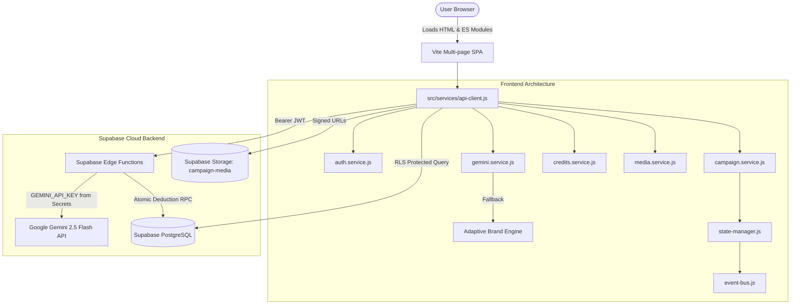

# MAILORA.AI — ARCHITECTURE DOCUMENTATION

## 1. System Overview

**Mailora.ai** is an Adaptive AI Email Marketing & Creative Studio built on a modern modular architecture designed for high throughput, absolute secret security, and resilient fallback modes.

---

## 2. Architectural Highlights

### 2.1 Separation of Responsibilities
1. **Frontend**: Pure Vanilla JavaScript ES Modules bundled with Vite. Zero framework bloat.
2. **API Client**: Centralized request dispatching with JWT retrieval, retry backoff, timeout handling, and idempotency protection for credit operations.
3. **AI Pipeline**:
   - Primary: Server-side Gemini 2.5 Flash with Gemini 2.0 Flash fallback via Supabase Edge Functions.
   - Secondary: Local Adaptive Brand Intelligence Engine (8 archetypes, 100+ patterns, 4 design directions) ensuring Mailora works offline or in Local Demo mode.
4. **Credit System**: Atomic server-side balance checking and deduction via PostgreSQL `deduct_user_credits` RPC function with `FOR UPDATE` row locking. Prevents concurrency race conditions and negative balances.
5. **Storage**: Large media objects are uploaded directly to Supabase Storage (`campaign-media`), storing only metadata in PostgreSQL.

---

## 3. Directory Layout

- `src/config/`: App configuration, API endpoints, Supabase initialization, and feature flags.
- `src/core/`: EventBus, StateManager, Lifecycle manager, and app bootstrap.
- `src/services/`: Centralized HTTP, Auth, Profile, Campaign, Credits, Media, BrandKit, Storage, and Telemetry services.
- `src/modules/ai/`: Brand intelligence, archetypes, prompt manager, response validator, variant manager, and anti-fabrication offer validator.
- `src/modules/email/`: Dynamic table-based HTML email renderer, two-way editor binding, mobile/desktop preview, and export.
- `src/modules/media/`: Hero generator, media library controller, image uploader.
- `src/modules/quality/`: Multi-factor QA scoring engine (Content, Design, Technical).
- `src/components/`: Modular UI widgets (Header, Sidebar, Draggable Floating Prompt, Adaptive Inspector, Cards, Modals, Toasts).
- `src/pages/`: Page orchestrators for `landing`, `login`, `signup`, and `studio`.
- `assets/css/`: Soft Modern Premium design tokens, global styles, components, and responsive styles.
- `supabase/`: Database migrations (001-007) and TypeScript Edge Functions.
- `tests/`: Automated Vitest test suites.
